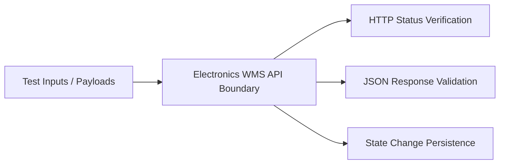
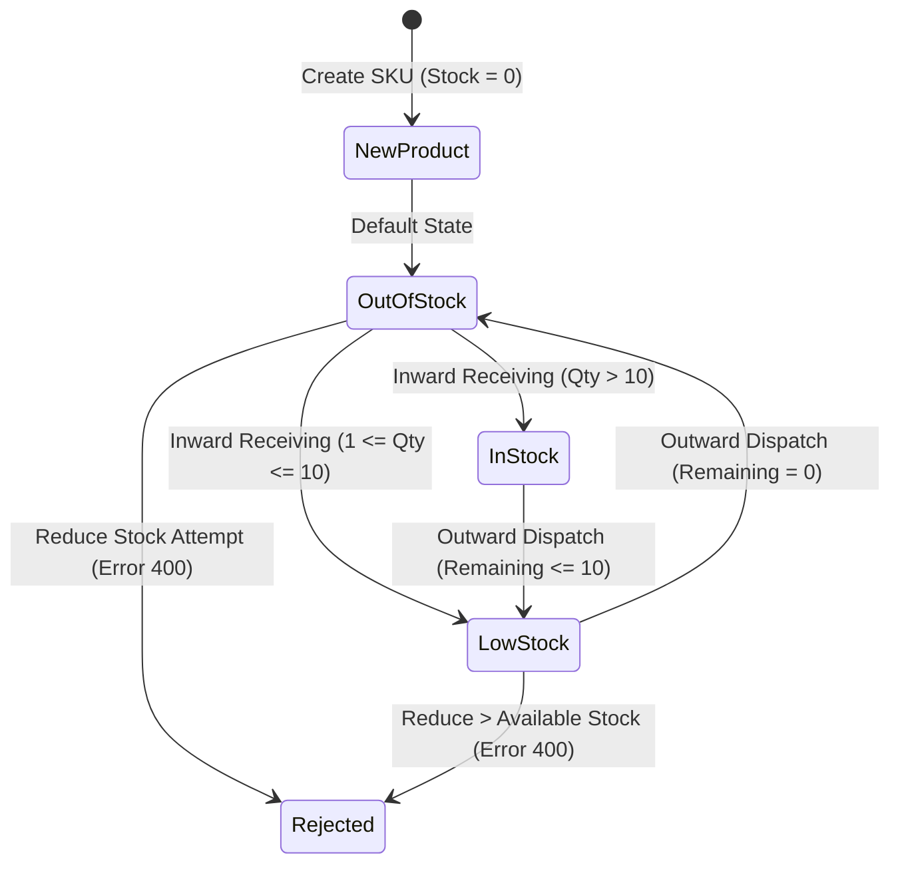

# Electronics Warehouse Management System — Black Box Test Suite

**Project:** Electronics Warehouse Management System (WMS)  
**Test Approach:** Specification-Based (Black Box) Software Testing  
**Jira References:** SCRUM-8 (Product Creation & Catalog), SCRUM-9 (Product Update), SCRUM-10 (Inventory Management)  
**Total Test Cases:** **30**  
**Execution Pass Rate:** **100% (30 / 30 Passed)**

---

## 1. Black Box Testing Methodology

Black Box Testing verifies the external functional behavior of the Electronics WMS without examining the internal source code or implementation details. Testing focuses on input domains, business rules, API contracts, boundary limits, and state transitions.

### Applied Test Design Techniques:
1. **Equivalence Partitioning (EP):** Dividing input domains into valid and invalid partitions (e.g. required string presence, valid numeric ranges).
2. **Boundary Value Analysis (BVA):** Testing minimum, maximum, just-below, and just-above boundary limits (e.g. unit prices at ₹0.00, ₹0.01, ₹999999.99, and zero stock boundary).
3. **State Transition Testing (ST):** Validating stock status lifecycle transitions (`Out of Stock (0)` &rarr; `In Stock` &rarr; `Low Stock (&le;10)` &rarr; `Depleted to 0`).
4. **Error Guessing & Robustness (EG/SEC):** Testing edge inputs including special characters, whitespace-only strings, type mismatches, and XSS script injections.

---

## 2. Complete Black Box Test Case Specification (30 Cases)

| Test ID | Module | Technique | Description | Method & Endpoint | Input Data | Expected Status & Result | Pass/Fail |
|---|---|---|---|---|---|---|---|
| **BB-01** | SCRUM-8 | Equivalence Partitioning (Valid) | Create new product with all valid required & optional fields | `POST /api/products` | ID: `PRD-901`, Name: `Apple iPad Air 11-inch`, Category: `Mobile & Tablets`, Price: `59900.00` | `201 Created`; JSON contains `success: true` | **PASS** |
| **BB-02** | SCRUM-8 | Equivalence Partitioning (Invalid) | Reject product creation when Product ID is omitted | `POST /api/products` | `productId=""`, valid other fields | `400 Bad Request`; `Product ID is required.` | **PASS** |
| **BB-03** | SCRUM-8 | Boundary / Error Guessing | Reject product creation with whitespace-only Product ID | `POST /api/products` | `productId="   "` | `400 Bad Request`; `Product ID is required.` | **PASS** |
| **BB-04** | SCRUM-8 | Boundary Value Analysis (Max) | Accept Product ID at maximum length boundary (20 characters) | `POST /api/products` | `productId="PRD-MAX-LENGTH-20CH"` (20 chars) | `201 Created`; product stored with 20-char ID | **PASS** |
| **BB-05** | SCRUM-8 | Equivalence Partitioning (Invalid) | Reject product creation when Name is missing | `POST /api/products` | `name=""` | `400 Bad Request`; `Product name is required.` | **PASS** |
| **BB-06** | SCRUM-8 | Equivalence Partitioning (Invalid) | Reject product creation when Category is empty | `POST /api/products` | `category=""` | `400 Bad Request`; `Category is required.` | **PASS** |
| **BB-07** | SCRUM-8 | Equivalence Partitioning (Invalid) | Reject product creation when Unit Price is missing | `POST /api/products` | `unitPrice=""` | `400 Bad Request`; `Unit price is required.` | **PASS** |
| **BB-08** | SCRUM-8 | Boundary Value Analysis (Min Valid) | Accept product creation with minimum positive unit price boundary (₹0.01) | `POST /api/products` | `unitPrice=0.01`, Name: `Budget Stylus Tip` | `201 Created`; price accepted at ₹0.01 | **PASS** |
| **BB-09** | SCRUM-8 | Boundary Value Analysis (Zero Invalid) | Reject product creation when Unit Price is zero (₹0.00) | `POST /api/products` | `unitPrice=0.00` | `400 Bad Request`; `Unit price must be greater than zero.` | **PASS** |
| **BB-10** | SCRUM-8 | Boundary Value Analysis (Negative) | Reject product creation when Unit Price is negative (₹-499.00) | `POST /api/products` | `unitPrice=-499.00` | `400 Bad Request`; `Unit price must be greater than zero.` | **PASS** |
| **BB-11** | SCRUM-8 | Error Guessing (Type Mismatch) | Reject product creation when Unit Price is non-numeric text | `POST /api/products` | `unitPrice="free"` | `400 Bad Request`; `Unit price must be a valid number.` | **PASS** |
| **BB-12** | SCRUM-8 | Boundary Value Analysis (Large Num) | Accept product creation with high-value enterprise pricing (₹999,999.99) | `POST /api/products` | `unitPrice=999999.99` | `201 Created`; stored with exact precision | **PASS** |
| **BB-13** | SCRUM-8 | Equivalence Partitioning (Conflict) | Reject duplicate Product ID with conflict error | `POST /api/products` | `productId="PRD-901"` (existing ID) | `409 Conflict`; `A product with ID 'PRD-901' already exists.` | **PASS** |
| **BB-14** | SCRUM-8 | Error Guessing (Special Chars) | Accept description with quotes, slashes, and symbols without crashing | `POST /api/products` | `description="8K DPI & quiet clicks; 100% precision!"` | `201 Created`; special characters preserved | **PASS** |
| **BB-15** | SCRUM-8 | Security (XSS Sanitization) | Sanitize HTML and script tags in product input fields | `POST /api/products` | `name=" USB Cable"` | `201 Created`; script escaped, XSS mitigated | **PASS** |
| **BB-16** | SCRUM-8 | Equivalence Partitioning (Read All) | Retrieve complete catalog listing | `GET /api/products` | None | `200 OK`; returns array of registered products | **PASS** |
| **BB-17** | SCRUM-8 | Equivalence Partitioning (Read Single)| Retrieve single product details by specific ID | `GET /api/products?id=WMS-101` | Query: `id=WMS-101` | `200 OK`; returns MacBook Pro record | **PASS** |
| **BB-18** | SCRUM-8 | Equivalence Partitioning (Not Found) | Return 404 when querying non-existent Product ID | `GET /api/products?id=GHOST-999` | Query: `id=GHOST-999` | `404 Not Found`; `Product 'GHOST-999' not found.` | **PASS** |
| **BB-19** | SCRUM-9 | Equivalence Partitioning (Update Valid)| Update existing product name, category, and price | `PUT /api/products` | `productId="PRD-901"`, `name="Apple iPad Air M2 11-inch"` | `200 OK`; details updated in database | **PASS** |
| **BB-20** | SCRUM-9 | Equivalence Partitioning (Update Invalid)| Reject update when updated product name is empty | `PUT /api/products` | `productId="PRD-901"`, `name=""` | `400 Bad Request`; `Product name is required.` | **PASS** |
| **BB-21** | SCRUM-9 | Boundary Value Analysis (Update Price)| Reject update when updated unit price is negative | `PUT /api/products` | `productId="PRD-901"`, `unitPrice=-10.00` | `400 Bad Request`; `Unit price must be greater than zero.` | **PASS** |
| **BB-22** | SCRUM-9 | Equivalence Partitioning (Update 404) | Reject update for non-existent product ID | `PUT /api/products` | `productId="NON-EXIST-888"`, valid fields | `404 Not Found`; `Product 'NON-EXIST-888' not found.` | **PASS** |
| **BB-23** | SCRUM-10 | Equivalence Partitioning (Inventory List)| Retrieve live warehouse stock status table | `GET /api/inventory` | None | `200 OK`; returns inventory items with stock levels | **PASS** |
| **BB-24** | SCRUM-10 | State Transition (Stock Inward) | Add stock quantity (Inward Receiving: +50 units) | `POST /api/inventory` | `action="add"`, `productId="PRD-901"`, `quantity=50` | `200 OK`; stock increments from 0 to 50 | **PASS** |
| **BB-25** | SCRUM-10 | Boundary Value Analysis (Min Stock Add)| Add smallest valid integer quantity (+1 unit) | `POST /api/inventory` | `action="add"`, `productId="PRD-901"`, `quantity=1` | `200 OK`; stock increments from 50 to 51 | **PASS** |
| **BB-26** | SCRUM-10 | State Transition (Stock Outward) | Reduce stock quantity for dispatch (Outward Dispatch: -20 units)| `POST /api/inventory` | `action="reduce"`, `productId="PRD-901"`, `quantity=20` | `200 OK`; stock decrements from 51 to 31 | **PASS** |
| **BB-27** | SCRUM-10 | Boundary / State Transition (Deplete 0)| Reduce exact available stock down to zero boundary | `POST /api/inventory` | `action="reduce"`, `productId="PRD-901"`, `quantity=31` | `200 OK`; stock becomes 0 (`Out of Stock`) | **PASS** |
| **BB-28** | SCRUM-10 | Boundary Value (Negative Prevention) | Reject stock reduction greater than available inventory | `POST /api/inventory` | `action="reduce"`, `productId="PRD-901"`, `quantity=5` (Stock is 0) | `400 Bad Request`; `Cannot reduce by 5. Current stock is only 0.` | **PASS** |
| **BB-29** | SCRUM-10 | Boundary Value (Zero Stock Movement) | Reject stock adjustment when quantity is zero (0 units) | `POST /api/inventory` | `action="add"`, `productId="PRD-901"`, `quantity=0` | `400 Bad Request`; `Quantity must be greater than zero.` | **PASS** |
| **BB-30** | SCRUM-10 | Error Guessing (Invalid Action) | Reject stock adjustment with unsupported action verb | `POST /api/inventory` | `action="discard"`, `productId="PRD-901"`, `quantity=5` | `400 Bad Request`; `Invalid action 'discard'.` | **PASS** |

---

## 3. State Transition Model for Inventory Stock

