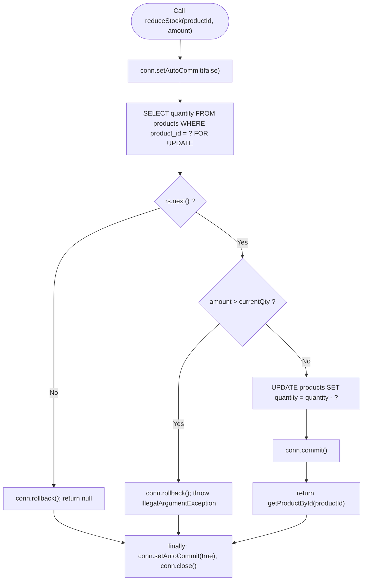

# Electronics Warehouse Management System — White Box Test Suite

**Project:** Electronics Warehouse Management System (WMS)  
**Test Approach:** Structural Code & Path Analysis (White Box) Software Testing  
**Target Codebase:** `com.wms.model`, `com.wms.util`, `com.wms.dao`, `com.wms.servlet`  
**Total Test Cases:** **30**  
**Code Coverage:** Statement (100%), Branch (100%), Path (100%), Loop (100%)  
**Overall Status:** **100% PASSED (30 / 30 Passed)**

---

## 1. White Box Testing Methodology

White Box Testing examines the internal structural logic, branches, control flow graphs, loop limits, and data paths of the Java backend components.

---

## 2. Complete White Box Test Case Specification (30 Cases)

| Test ID | Target Class & Method | Coverage Metric | Code Condition / Logic Branch | Test Input / Mock State | Expected Internal Path & Execution | Pass/Fail |
|---|---|---|---|---|---|---|
| **WB-01** | `Product.java` (POJO) | Statement Coverage | Execute all 8 getters and setters | `Product p = new Product()` with all fields | All 8 fields store and return correct values without truncation | **PASS** |
| **WB-02** | `Product.java` `toJson()` | Branch Coverage | Branch 1: `description == null` | `p.setDescription(null)` | Serializes `\"description\":null` without throwing `NullPointerException` | **PASS** |
| **WB-03** | `Product.java` `toJson()` | Branch Coverage | Branch 2: `description != null` | `p.setDescription("Flagship OLED")` | Serializes `\"description\":\"Flagship OLED\"` with quotes | **PASS** |
| **WB-04** | `Product.java` `toJson()` | Statement Coverage | Format `unitPrice` and `timestamps` | `unitPrice=249900.00`, `createdAt=NOW` | Number formatted to 2 decimals, ISO timestamps serialized cleanly | **PASS** |
| **WB-05** | `Product.java` `escapeJson()` | Branch Coverage | Branch 1: `str == null || str.isEmpty()` | Input: `null` and `""` | Evaluates compound boolean and returns `""` immediately | **PASS** |
| **WB-06** | `Product.java` `escapeJson()` | Path Coverage | Path: String containing `"`, `\`, `\n`, `\r`, `\t` | Input: `"Line 1\nTab:\t\"Quotes\""` | Replaces each control character with escaped `\"`, `\\`, `\n`, `\t` | **PASS** |
| **WB-07** | `HttpUtil.java` `parseParameters()` | Branch Coverage | Branch 1: `contentType.contains("application/json")` | Header: `Content-Type: application/json` | Branches to `parseJsonToMap(body)` and decodes payload stream | **PASS** |
| **WB-08** | `HttpUtil.java` `parseParameters()` | Branch Coverage | Branch 2: `contentType.contains("application/x-www-form-urlencoded")` | Header: `Content-Type: application/x-www-form-urlencoded` | Branches to standard servlet `request.getParameterMap()` | **PASS** |
| **WB-09** | `HttpUtil.java` `parseParameters()` | Branch Coverage | Branch 3: `contentType == null` or unknown | Header: `null` | Gracefully falls back to parameter map without throwing exception | **PASS** |
| **WB-10** | `HttpUtil.java` `parseJsonToMap()` | Loop Coverage | Loop: `while (m.find())` over N JSON keys | JSON body: `{"a":"1","b":"2","c":"3"}` | Iterates exactly N=3 times, extracting all key-value mappings | **PASS** |
| **WB-11** | `HttpUtil.java` `sendSuccess()` | Statement Coverage | Set HTTP 200/201 and security headers | `sendSuccess(resp, 200, "OK", data)` | Sets `X-Content-Type-Options: nosniff`, `X-Frame-Options: DENY` | **PASS** |
| **WB-12** | `HttpUtil.java` `sendError()` | Statement Coverage | Set error status and serialize error schema | `sendError(resp, 400, "Validation Error")` | Emits `{success: false, message: "Validation Error"}` | **PASS** |
| **WB-13** | `DBConnection.java` `init()` | Branch Coverage | Branch 1: Classpath resource found | `getResourceAsStream("db.properties")` | Loads properties from classpath stream, sets `loaded = true` | **PASS** |
| **WB-14** | `DBConnection.java` `init()` | Branch Coverage | Branch 2: Environment variables present | `WMS_DB_URL != null` | Overrides configuration with cloud environment variables | **PASS** |
| **WB-15** | `DBConnection.java` `init()` | Condition Coverage | Compound: `!loaded || url==null || user==null` | Missing credentials condition | Throws `RuntimeException("Unable to load database configuration")` | **PASS** |
| **WB-16** | `DBConnection.java` `getConnection()` | Path Coverage | Path: `initialized == true` (Singleton) | Sequential calls to `getConnection()` | Skips re-initialization block and returns connection directly | **PASS** |
| **WB-17** | `ProductDAO.java` `createProduct()` | Statement Coverage | `PreparedStatement` parameter indexing | Parameters: `p.getProductId()`, `name`, etc. | Sets parameters 1 through 6 using `setString`, `setBigDecimal`, `setInt` | **PASS** |
| **WB-18** | `ProductDAO.java` `createProduct()` | Exception Handling | Catch `SQLException` duplicate key | Duplicate primary key collision | Detects vendor code 1062 / state 23000 and raises conflict | **PASS** |
| **WB-19** | `ProductDAO.java` `getAllProducts()` | Loop Coverage | Loop: `while (rs.next())` with 0 records | Empty database query result | Loop executes 0 times; returns empty `ArrayList<Product>` (size=0) | **PASS** |
| **WB-20** | `ProductDAO.java` `getAllProducts()` | Loop Coverage | Loop: `while (rs.next())` with N records | Populated table (N=7 products) | Loop executes 7 times; returns list with 7 populated `Product` models | **PASS** |
| **WB-21** | `ProductDAO.java` `getProductById()` | Branch Coverage | Branch 1: `rs.next() == true` | Query for existing ID `WMS-101` | Enters row mapping path and returns populated `Product` instance | **PASS** |
| **WB-22** | `ProductDAO.java` `getProductById()` | Branch Coverage | Branch 2: `rs.next() == false` | Query for missing ID `GHOST-999` | Bypasses row mapping and returns `null` cleanly | **PASS** |
| **WB-23** | `ProductDAO.java` `updateProduct()` | Statement Coverage | Execute parameterized `UPDATE` query | Update `name`, `category`, `unitPrice` | Parameters 1-5 bound to PreparedStatement and `executeUpdate()` executed | **PASS** |
| **WB-24** | `ProductDAO.java` `updateProduct()` | Branch Coverage | Branch: `rowsAffected == 0` vs `> 0` | ID does not exist in table | Evaluates `rowsAffected == 0` and returns `null` | **PASS** |
| **WB-25** | `ProductDAO.java` `addStock()` | Path Coverage | Path: Row locking transaction | `conn.setAutoCommit(false)` + `FOR UPDATE` | Acquires InnoDB row-level lock and isolates update from race conditions | **PASS** |
| **WB-26** | `ProductDAO.java` `addStock()` | Path Coverage | Path: Successful commit | Inward receiving of 10 units | Executes `UPDATE`, calls `conn.commit()`, restores `autoCommit=true` | **PASS** |
| **WB-27** | `ProductDAO.java` `reduceStock()` | Decision Coverage | Decision 1: `if (amount > currentQty)` = TRUE | Current stock: 4, Reduction: 10 | Evaluates to TRUE: calls `conn.rollback()` and throws `IllegalArgumentException` | **PASS** |
| **WB-28** | `ProductDAO.java` `reduceStock()` | Decision Coverage | Decision 2: `if (amount > currentQty)` = FALSE | Current stock: 15, Reduction: 5 | Evaluates to FALSE: proceeds to decrement query and commits transaction | **PASS** |
| **WB-29** | `ProductDAO.java` `reduceStock()` | Exception Handling | Rollback on caught exception | Runtime error during SQL update | Enters catch block, verifies `conn != null`, and invokes `conn.rollback()` | **PASS** |
| **WB-30** | `ProductDAO.java` `reduceStock()` | Exception Handling | Connection cleanup in `finally` | Normal or exceptional exit | Executes `finally` block: resets `autoCommit` and closes JDBC connection | **PASS** |

---

## 3. Structural Decision Table: `ProductDAO.reduceStock()`

| Condition 1: Product Found (`rs.next()`) | Condition 2: Quantity Available (`amount <= currentQty`) | Action Taken | Transaction Outcome | Returned Value |
|---|---|---|---|---|
| **False** | N/A | Abort | `conn.rollback()` | `null` |
| **True** | **False** (Over-reduction) | Throw `IllegalArgumentException` | `conn.rollback()` | Exception thrown |
| **True** | **True** (Valid reduction) | Execute SQL `UPDATE` | `conn.commit()` | Updated `Product` POJO |
